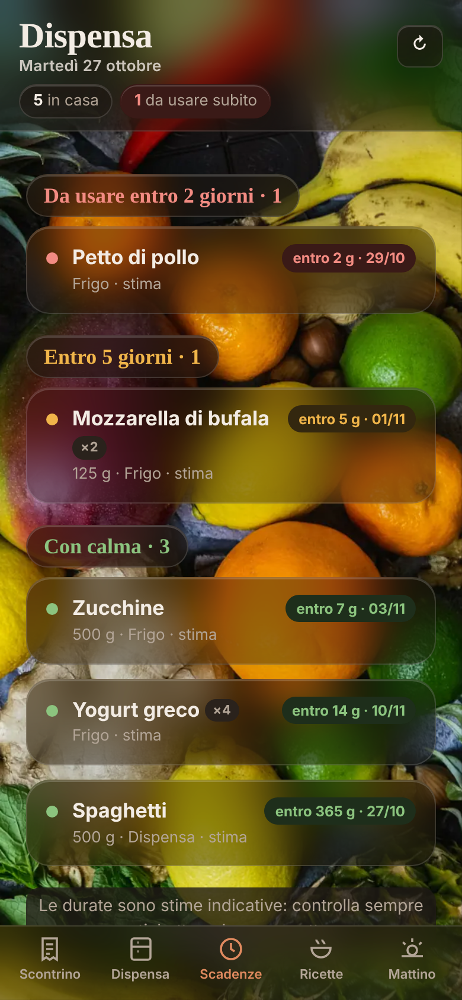

# Dispensa

**La dispensa di casa sull'iPhone: fotografi lo scontrino, Claude legge le righe, l'app ti dice cosa usare per primo e propone ricette con quello che sta per scadere.**



Progetto personale nato come reparto del mio assistente [Jarvis](#origine) e poi reso autonomo.
Gira sul Mac di casa e si apre dall'iPhone come un'app, anche fuori casa, senza esporre nulla a Internet.

## Cosa fa

- **Scontrino → dispensa**: foto o testo dello scontrino; Claude interpreta le abbreviazioni («MOZZ.FDL 125G» → «Mozzarella fior di latte»), tu confermi o correggi. Le correzioni vengono ricordate per gli scontrini successivi. La foto non viene salvata.
- **Scadenze stimate**: tabella categoria × luogo (frigo, dispensa, freezer) × aperto/chiuso, con fonti (USDA FoodKeeper, EFSA, Ministero della Salute). La data in etichetta vince sempre; aprire un prodotto accorcia la durata.
- **Pezzi uguali**: «Mozzarella ×2» — apri, finisci o butti un pezzo alla volta; quello aperto diventa una scheda con la sua scadenza.
- **Annulla e cestino**: ogni «finito» o «buttato» si annulla per 6 secondi; il cestino tiene gli ultimi 14 giorni e un pezzo ripescato torna nella sua confezione.
- **Ricette del giorno**: 3 ricette mediterranee che usano per primi gli ingredienti in scadenza; «L'ho cucinata» li toglie dalla dispensa.
- **Riepilogo del mattino** su Telegram (facoltativo).
- **Fascia oraria** (default 9–20): fuori orario la Dispensa riposa e il Mac può andare in stop.

## Come funziona

```
iPhone (Safari, icona sulla Home)
   │  HTTPS solo dentro la rete privata Tailscale
   ▼
tailscale serve :8444 ──► Flask su 127.0.0.1:8770 (app.py)
                              ├─ accesso.py    controllo d'ingresso: solo Mac o Tailscale + PIN
                              ├─ dispensa.py   logica: durate, pezzi, cestino, ricette
                              ├─ Claude API    lettura scontrini e ricette (SDK anthropic)
                              ├─ notifiche.py  riepilogo su Telegram
                              └─ dati/*.json   archivio locale, scritture atomiche (fuori da git)
```

Scelte principali:
- **JSON invece di un database**: un solo utente, poche centinaia di prodotti; i file si leggono a occhio e si copiano per il backup.
- **Una sola pagina HTML senza build**: niente Node né bundler, la pagina è servita così com'è.
- **Il server ascolta solo su 127.0.0.1**: dall'esterno passa solo Tailscale, e serve comunque il PIN.

## Tecnologie

Python 3.11 · Flask · Anthropic SDK (Claude) · HTML/CSS/JS senza framework · Tailscale · launchd (macOS) · pytest · GitHub Actions

## Avvio sul Mac

```bash
git clone https://github.com/Umano17/dispensa.git && cd dispensa
python3 -m venv .venv && source .venv/bin/activate
pip install -r requirements.txt
cp .env.example .env      # inserisci ANTHROPIC_API_KEY e DISPENSA_PIN
python app.py             # http://127.0.0.1:8770/dispensa
```

Avvio automatico all'accesso (LaunchAgent di macOS, si riavvia da solo se si blocca):

```bash
bash avvio/installa.sh            # per toglierlo: bash avvio/installa.sh --togli
```

### Dall'iPhone

1. Tailscale sul Mac e sull'iPhone, con lo stesso account.
2. Sul Mac: `tailscale serve --bg --https=8444 http://127.0.0.1:8770`
3. Sull'iPhone apri `https://<nome-mac>.<rete>.ts.net:8444/dispensa`, inserisci il PIN, poi Condividi → **Aggiungi alla schermata Home**.

## Sicurezza

- Dal Mac le API accettano solo richieste partite dalla pagina stessa (controllo `Host` e `Origin`): un altro sito aperto nel browser non può usarle di nascosto.
- Da fuori: solo dispositivi della propria rete Tailscale (intestazione `Tailscale-User-Login`, assente con Funnel), solo HTTPS, PIN obbligatorio; il telefono resta riconosciuto 30 giorni con un cookie firmato (HMAC); 5 PIN sbagliati bloccano l'accesso per 15 minuti.
- Chiavi e PIN solo nel file `.env`, escluso da git insieme ai dati.

## Test

```bash
pip install -r requirements-dev.txt
pytest -q
```

35 test su durate, urgenza, pezzi, cestino, ricette (con Claude simulato, quindi gratis), controllo d'ingresso e fascia oraria. Girano a ogni push con GitHub Actions.

## Limiti

- Un solo utente, nessun account: è pensata per una casa.
- Funziona finché il Mac è acceso e sveglio; se dorme alle 9, la Dispensa riparte quando lo apri.
- Le durate sono stime indicative: controlla sempre etichetta, odore e aspetto.
- La lettura degli scontrini dipende dalla qualità della foto e costa qualche centesimo per scontrino (API Claude).

## Origine

Dispensa è nata da uno **studio di fattibilità** (mercato, costi per utente, aspetti legali) con un prototipo React + FastAPI, poi è diventata un reparto di Jarvis, il mio assistente personale in Python. Qui è stata separata in un progetto autonomo: server proprio, accesso con PIN, test e avvio automatico.

## Crediti

Foto di sfondo da [Unsplash](https://unsplash.com) (licenza Unsplash), una diversa ogni settimana: [Ella Olsson](https://unsplash.com/photos/7EhPbdAQG-s), [Jona Novak](https://unsplash.com/photos/dX-LUtha_Hs), [Josefin](https://unsplash.com/photos/s0fuB1h3yPw).
